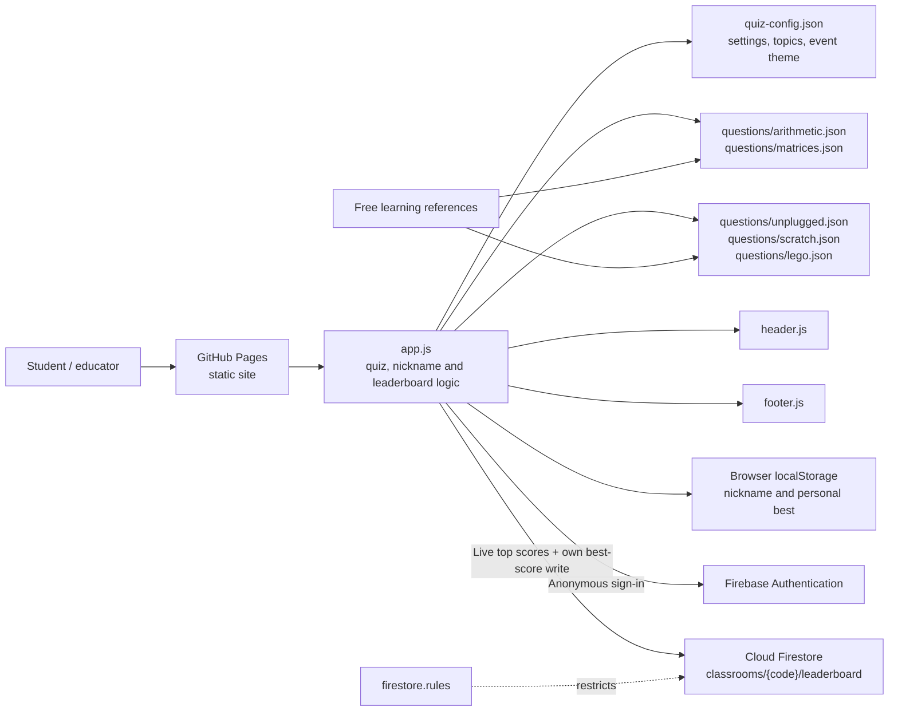

# Maths for AI

A static, educator-customizable learning game for higher-secondary students. Short quizzes connect arithmetic, matrices, unplugged computer science, Scratch and LEGO robotics to ideas behind artificial intelligence. Each answer or timeout leads to a clue, worked explanation, AI connection and a source link.

The learning philosophy is **competitive encouragement**: students can celebrate progress and compare their best scores with classmates, while mistakes remain safe opportunities to learn. Streaks recognise persistence; they do not take points away.

## What students see

- Five independent topic choices and an optional mixed session.
- A configurable question timer, points, progress display and immediate explanations.
- A consecutive-correct streak, milestone bonus points and the best streak in the results.
- A Firebase class leaderboard with a generated or editable anonymous nickname.
- A confirmation before the header's `math/ai` home link abandons an active quiz.
- A local personal-best score even when Firebase is not configured.

Students can play without signing in themselves: the optional leaderboard uses Firebase Anonymous Authentication. The app does not ask for student names, email addresses or other personal profile information. Encourage students to keep their nicknames anonymous.

## Run locally

The app loads JSON with `fetch`, so serve the directory over HTTP instead of opening `index.html` from the filesystem.

1. Install Python 3 if necessary.
2. From this folder, run `python3 -m http.server 8000`.
3. Visit <http://localhost:8000>.

No packages or build step are needed. Stop the local server with `Ctrl+C`.

## Static GitHub Pages + Firebase hosting model

GitHub Pages hosts the HTML, CSS, JavaScript and JSON; Firebase provides Anonymous Authentication and Cloud Firestore.

1. Push the project files to the repository. Enable **Settings → Pages**, choose the branch and `/ (root)` directory, and save.
2. Use the resulting HTTPS Pages URL. Relative imports and JSON paths let the app work from a project repository subpath.
3. In Firebase, enable **Authentication → Sign-in method → Anonymous** and create a Cloud Firestore database.
4. Add the GitHub Pages hostname (for example, `school.github.io`) and local host (`localhost`) in Firebase Authentication's **Authorized domains**.
5. Add Firebase's web configuration to [`firebase-config.json`](./firebase-config.json), set `"enabled": true`, and publish [`firestore.rules`](./firestore.rules) in Firestore Rules.
6. Test with two browsers or private sessions using the same class code. Their best scores should appear on the same board.

Firebase's web configuration is public client configuration, not a server secret. Firestore rules—not hidden JavaScript values—control access. Add Firebase App Check, quotas and a data-retention policy before public use. The question files and app are static public files, so do not store answer keys or private data in a database accessible to the browser.

## Streaks: learning encouragement, not only score

A **streak is the number of questions a student answers correctly in a row**. For example:

| Question | Result | Current streak | What happens |
| --- | --- | ---: | --- |
| 1 | Correct | 1 | First successful step |
| 2 | Correct | 2 | The game celebrates consistency |
| 3 | Correct | 3 | With the default settings, this milestone also earns a bonus |
| 4 | Incorrect or timed out | 0 | The current run ends; earlier points and progress remain |
| 5 | Correct | 1 | A new run starts immediately |

### Why use a streak?

The streak is a small, visible sign of **momentum and growing confidence**. It acknowledges several successful attempts in succession, gives the learner an achievable next goal (“one more correct answer”), and provides quick positive feedback during play. The game also records the **best streak for that session**, so a learner can see a personal achievement even if a later answer breaks the run.

It is **not just another way to inflate the score**:

- The streak badge and short encouragement messages make progress visible at the moment it happens.
- A streak can grow even before the next point bonus is reached.
- The results include best streak as its own measure, separate from points and accuracy.
- A wrong answer never subtracts points, never erases completed questions and never affects the personal best score. Only the *current consecutive run* returns to zero.
- The clue and solution appear after a wrong answer or timeout. Learners can understand what happened, then start a fresh run on the next question.
- Correct answers remain the goal, but feedback is about effort and the next step—not shame or punishment.

The class leaderboard adds friendly competition, but it does not replace private progress or learning. Educators can invite students to beat their own best streak, celebrate improvement, or work as teams instead of treating rank as a grade. For a lower-pressure session, turn off the streak and bonus or hide the class leaderboard in the configuration.

### Configure streak behavior

In [`quiz-config.json`](./quiz-config.json):

```json
"experience": {
  "streak": {
    "enabled": true,
    "bonusEvery": 3,
    "bonusPoints": 5
  },
  "streakMinimumForMessage": 2
}
```

- `enabled`: show the streak indicator and best-streak result, and apply milestone bonuses.
- `bonusEvery`: award the bonus after this many consecutive correct answers, and again at each multiple. For example, `3` gives bonuses on correct answers 3, 6 and 9 of a single run.
- `bonusPoints`: extra points for each milestone; use `0` for encouragement without extra score.
- `streakMinimumForMessage`: show the longer streak encouragement at this current-streak length. This message does not itself award bonus points.
- A wrong answer **or timeout** resets the current run. It does not reduce the score already earned.

With the default eight-question session, 10 base points per correct answer and a 5-point bonus every three consecutive correct answers, an all-correct session earns 90 points: 80 base points plus bonuses at streak lengths 3 and 6. The configuration is validated so the theoretical maximum session score stays at or below 1000, matching the Firestore rule.

To make the experience less competitive, set `"enabled": false` and/or set `"bonusPoints": 0`. The app then hides the current streak and best-streak result while retaining supportive correctness messages.

## Customize the question bank

The configuration and subject content are deliberately split so a subject expert can maintain just one topic without navigating a large settings file.

### High-level settings and topic catalogue

Edit [`quiz-config.json`](./quiz-config.json). It stores:

- session length, time and base points;
- appearance sizes and encouragement text;
- streak and mixed-session behavior;
- anonymous leaderboard settings;
- event branding, header image and theme colors;
- topic ID, display name, card icon, description and question-file path.

It does **not** contain the question sets. Keep this file valid JSON: use double quotes and commas between values, but no trailing comma after the final item.

### Subject-expert question files

The `categories` list points to separate files:

| Topic ID | Question file |
| --- | --- |
| `arithmetic` | [`questions/arithmetic.json`](./questions/arithmetic.json) |
| `matrices` | [`questions/matrices.json`](./questions/matrices.json) |
| `unplugged` | [`questions/unplugged.json`](./questions/unplugged.json) |
| `scratch` | [`questions/scratch.json`](./questions/scratch.json) |
| `lego` | [`questions/lego.json`](./questions/lego.json) |

Each file contains its own `questions` array. Question authors can edit one domain file without touching the application or another domain. Each individual topic needs at least the configured `questionCount` questions.

```json
{
  "questions": [
    {
      "prompt": "What is 15% of 240?",
      "options": ["36", "24", "30", "40"],
      "answer": "36",
      "hint": "Find 10% and 5% separately, then add them.",
      "solution": "10% of 240 is 24 and 5% is 12. Together, 24 + 12 = 36.",
      "aiConnection": "Percentages help us interpret proportions in data.",
      "sourceTitle": "Khan Academy · Arithmetic",
      "sourceUrl": "https://www.khanacademy.org/math/arithmetic"
    }
  ]
}
```

For each question, include exactly four different, non-empty choices; `answer` must exactly match a choice. Add a useful `hint`, worked `solution`, simple `aiConnection`, `sourceTitle` and `http`/`https` `sourceUrl`. The browser validates the files before allowing the quiz to start. Refresh the page after JSON changes.

### Add another domain

1. Add a new question file under `questions/`, such as `questions/statistics.json`.
2. Add a new category in `quiz-config.json` with an unused lowercase ID, label, optional icon and description, and its `questionFile` path:

```json
"statistics": {
  "label": "Statistics",
  "icon": "📊",
  "description": "Explore data, averages and variation",
  "questionFile": "questions/statistics.json"
}
```

3. Add at least `questionCount` question records to that file.
4. Refresh the app and check that the new topic card appears. Mixed practice includes all categories automatically.

Topic IDs use lowercase letters, numbers and hyphens, begin with a letter, and may not be `mixed`. Question paths must be under `questions/`.

### More session settings

| JSON path | Purpose |
| --- | --- |
| `settings.questionCount` | Number of questions per session, 1–50 |
| `settings.secondsPerQuestion` | Timer per question, 5–3600 seconds |
| `settings.pointsPerCorrect` | Base score for a correct answer |
| `experience.allowMixed` | Show or hide the mixed-topic card |
| `experience.randomizeQuestions` | Shuffle questions each session |
| `experience.randomizeOptions` | Shuffle answer choices each question |
| `experience.messages` | Change positive/incorrect/timeout/result encouragement |
| `copy` | Change setup, streak explanation, privacy and leaderboard messages |
| `leaderboard.enabled` | Show or hide leaderboard and nickname controls |
| `leaderboard.topCount` | Number of leaderboard rows to display, 1–25 |
| `leaderboard.defaultClassCode` | Optional teacher-provided class code pre-filled on devices |
| `leaderboard.nicknameMinLength` / `nicknameMaxLength` | Nickname length limits, 3–30 characters |
| `leaderboard.classCodeMinLength` / `classCodeMaxLength` | Class-code length limits, 4–16 characters |
| `appearance.quizTopicFontSizePx` | Topic label font size |
| `appearance.quizDetailFontSizePx` | Question counter font size |
| `appearance.quizScoreFontSizePx` | Score font size |
| `appearance.quizStreakFontSizePx` | Streak font size |
| `appearance.quizMetaGapPx` | Space between the topic, counter, score and streak |
| `appearance.quizQuestionFontSizePx` | Main question font size |
| `appearance.quizAnswerFontSizePx` | Answer-choice font size |

Appearance font sizes and spacing are 8–32 pixels. The question and answer sizes are applied to the `--quiz-question-font-size` and `--quiz-answer-font-size` custom properties in [`styles.css`](./styles.css). The JSON values take precedence; changing the CSS defaults is an alternative if you prefer to customize styles directly.

For example, to make questions and options larger, edit the `appearance` section of [`quiz-config.json`](./quiz-config.json), then refresh the page:

```json
"appearance": {
  "quizQuestionFontSizePx": 26,
  "quizAnswerFontSizePx": 18
}
```

The current defaults are 24px for questions and 16px for answer options. Increase or decrease those values (8–32) to suit your students and screen size.

## Anonymous class leaderboard

The leaderboard uses the teacher-shared class code as a **board selector**, not as a password. A student enters a nickname and class code; the app signs in with Firebase Anonymous Authentication. Each anonymous Firebase user has one best-score entry **per nickname per class**. This means multiple students who share a device/browser can use different nicknames and keep separate rows. Reusing the same nickname in that browser updates that nickname's row; a lower score does not replace its higher score. The top `leaderboard.topCount` entries are shown in real time, ordered by score.

Nicknames are generated in [`app.js`](./app.js) from friendly words plus digits, can be edited by a student, and are saved in that browser's local storage. A teacher can pre-fill a shared class code with `leaderboard.defaultClassCode`. If no valid class code is entered, or Firebase is unavailable, the quiz remains playable and saves only the device-local personal best.

A valid nickname and class code are required to join the board, but neither is required to play. If either is missing or invalid, the leaderboard displays a helpful message and the session can still be completed locally.

### Firebase setup

The **class code is chosen by you**, the educator. It is an ordinary text value that the app uses as the name/selector for a class board. It is **not** a Firebase-generated value, Firebase configuration variable, API key, password, or a record you need to create in the Firebase Console.

For example, you could choose `MATHS-2026-A` for one class and `MATHS-2026-B` for another. Codes must be 4–16 characters and contain only uppercase letters, digits, or hyphens. The app converts student input to uppercase. Every student who should see the same scores must use exactly the same code.

Follow these steps to enable a shared class board:

1. **Set up Firebase once for the app.** In the [Firebase Console](https://console.firebase.google.com/), create/select a project, add a Web app, create a Cloud Firestore database, and enable **Authentication → Sign-in method → Anonymous**.
2. **Connect this static website to Firebase.** Add your local and GitHub Pages hostnames in **Authentication → Settings → Authorized domains**. Copy the Web app configuration values into [`firebase-config.json`](./firebase-config.json) (`apiKey`, `authDomain`, `projectId`, `appId`) and change `"enabled": false` to `"enabled": true`. These web app values identify the Firebase project; they are not the class code.

2.1. In Project settings → General, register a Web app and copy its Firebase web configuration into firebase-config.js.
2.2. These web config values identify the Firebase project; they are not server secrets. Keep Firestore locked down with the rules below.
2.3. In Authentication → Sign-in method, enable Anonymous sign-in.
2.4. In Authentication → Settings → Authorized domains, add localhost for local tests and your GitHub Pages domain (for example, your-name.github.io) for the deployed game.
2.5. Create a Cloud Firestore database. Open Firestore Database → Rules, replace the starter rules with the contents of firestore.rules, and publish them.

3. **Publish the database rules.** In **Firestore Database → Rules**, publish the contents of [`firestore.rules`](./firestore.rules) to the same Firebase project. The rules permit valid codes and limit writes to each anonymous user's own score document.
4. **Choose a code for each class.** Make up a memorable code such as `MATHS-2026-A`. Keep it 4–16 characters, using only A–Z, 0–9, and hyphens. Do not treat it as a secret: anyone who knows the code can view/join that board.
5. **Choose how students receive the code:**
   - To prefill one board code for everyone using this deployment, edit the existing `leaderboard` section in [`quiz-config.json`](./quiz-config.json):

     ```json
     "leaderboard": {
       "enabled": true,
       "topCount": 10,
       "defaultClassCode": "MATHS-2026-A",
       "nicknameMinLength": 3,
       "nicknameMaxLength": 18,
       "classCodeMinLength": 4,
       "classCodeMaxLength": 16
     }
     ```

     Keep the other leaderboard settings and commas valid JSON. Publish the updated file with the site. Students may still change the prefilled code.
   - To support **several classes on the same deployment**, leave `"defaultClassCode": ""`. Tell each class its own code, and have students enter it in the **Class code** field beside their nickname. Students in the same class must enter the same code. You can also publish separate copies of the site with a different default code in each copy.
6. **Deploy and test.** Publish/reload the site after editing its JSON files. Open it in two separate browser profiles, enter the same class code and different nicknames, complete a quiz in both, then check that both entries appear on that code's board. A score is written after a quiz is completed, so the board may be empty until the first student finishes.

**You do not create a class or collection manually in Firestore.** When the first completed quiz successfully submits a score with a particular code, Firestore creates the path automatically:

```text
classrooms/{CLASS_CODE}/leaderboard/{ANONYMOUS_UID}_{NORMALIZED_NICKNAME}
```

For example, a student using `MATHS-2026-A` writes beneath `classrooms/MATHS-2026-A/leaderboard/`. Each record ID combines that browser's anonymous Firebase UID with a normalized nickname, so two nicknames on one device get different records. A different code selects a different path and therefore a different board. The app listens for the top scores for the entered code; before the first score is saved, that board has no entries.

If you already tested with the earlier one-record-per-browser version, its existing document is not automatically removed. After publishing the new rules, each nickname will create/update its own new-format row; you may delete the old test document from Firestore if you do not want that earlier row to remain visible.

If Firebase is not configured, scores cannot be shared regardless of the class code. The example [`firebase-config.json`](./firebase-config.json) may be disabled until you enter your Firebase Web app settings and enable it; the quiz still works, but scores remain local to each browser. Once Firebase is connected, the leaderboard appears beside the topic chooser on desktop and below it on smaller screens.

Each record contains the owning anonymous UID, nickname, topic, score, question count, correct count, best streak and a server timestamp. For example, two nicknames on one browser create separate document IDs under the same class path. The rules allow authenticated users to list the class board, but only to create, update or delete records carrying their own authenticated UID; updates cannot lower the score for that nickname. They cannot edit another user's score or delete another user's entry. As this is a static client app, anonymous users can choose nicknames freely, so use it for friendly practice rather than verified student identity.

### Troubleshooting: “Missing or insufficient permissions”

If the page says **Firebase connected** but then reports **Missing or insufficient permissions**, Anonymous Authentication worked; Firestore rejected the leaderboard read. This is different from a Firebase connection/API-key failure. Check these items:

1. In `firebase-config.json`, note the `projectId`. In the Firebase Console, switch to that exact project before editing rules. It is easy to publish rules to a different project.
2. Open **Firestore Database → Rules**, confirm the rules are published (not only typed in the editor), and verify the deployed rules include a match for `/classrooms/{classCode}/leaderboard/{studentId}` with an authenticated `allow list` for the leaderboard query. The checked-in [`firestore.rules`](./firestore.rules) is the intended rules file; publish it again after updating the app to the per-nickname entry format.
3. Check that the code entered in the page is 4–16 characters and contains only uppercase letters, digits and hyphens. Every student must use the same code. For example, `MATHS-2026-A`.
4. Confirm the Firestore database exists in that project, refresh the quiz after publishing the rules, and check the leaderboard status again.
5. If it still fails, open the browser developer console and read the Firebase error code. `permission-denied` points to Firestore rules/project/code; `auth/unauthorized-domain` means the site's hostname is missing from Authentication's authorized domains; `auth/operation-not-allowed` means Anonymous sign-in is not enabled.

The app now reports this Firebase error category in the leaderboard panel instead of replacing all Firestore failures with a generic message. Never publish private service-account credentials in this static website; the browser should use only the Firebase Web app configuration.

If leaderboard reads work but finishing a quiz says **Score could not be shared**, publish the latest [`firestore.rules`](./firestore.rules) again. The app checks whether the current nickname's document exists before writing it. For a first-time nickname, the document does not exist yet, so the rules must allow an authenticated user to read a document ID beginning with their own anonymous UID. The current rules permit that check and then allow creation only when the new record also contains the matching `ownerUid`.

### Privacy, fairness and leaderboard limits

- A class code separates classrooms **for convenience**, not security. Anyone who knows a code and can sign in anonymously can join or view that board. Do not use a class code for confidential data.
- Nicknames and scores on the selected board are visible to other users of that board. Do not use real names, email addresses, student IDs or sensitive information as nicknames.
- Firebase Authentication UID is anonymous, not a verified student identity. On another browser/device, a student may receive a new anonymous UID and therefore a separate leaderboard row.
- Scores are calculated in browser JavaScript. A motivated user can alter a static web app or submit a dishonest score; the rules enforce data shape and score bounds, not academic integrity. This board is for friendly practice, **not grades or a tamper-proof competition**.
- The leaderboard keeps one best entry per anonymous UID, nickname and class, not every attempt. It does not store a class roster or teacher identity. No teacher dashboard or account recovery flow is included.
- Use Firebase App Check, reasonable quotas and classroom privacy/consent policies before a public launch. Decide how teachers will remove entries if needed.

If Firebase is disabled or fails, the local quiz still works; cloud and local save states are reported separately.

## Event branding and page components

The page's reusable header and footer are independent JavaScript components:

- [`header.js`](./header.js) renders the brand link, headline, event eyebrow and optional hero image.
- [`footer.js`](./footer.js) renders the encouragement footer and closing line.

Edit the `branding` object in `quiz-config.json` to customize site name, brand mark, headline, footer text and the primary colors for an event. To add an event photo or illustration, set `heroImageUrl` to an image path in the repository (recommended for GitHub Pages) or an HTTPS image URL. For example:

```json
"heroImageUrl": "./assets/science-fair-header.jpg",
"heroImageAlt": "Colourful science fair project display",
"theme": {
  "primary": "#176b87",
  "primaryDark": "#10536b",
  "page": "#f2f8fa"
}
```

Put local event images in an `assets/` directory, keep image sizes reasonable for mobile, and write meaningful alt text (or leave it empty for a purely decorative image). If no image path is supplied, the header shows the built-in maths illustration. The header image must be hosted with the app or use HTTPS. Other layout details remain editable in [`styles.css`](./styles.css).

## Learning sources and question authorship

The question wording, options, clues, worked solutions and AI connections in this project were authored for this quiz. They were **not downloaded from a question API or copied verbatim** from the linked learning resources. Each question's source is included as a free place to learn more about the underlying concept; review sources, curriculum fit and licensing before adapting for class.

| Topic | Free concept references |
| --- | --- |
| Arithmetic | [Khan Academy — Arithmetic](https://www.khanacademy.org/math/arithmetic) |
| Matrices | [Math is Fun — Introduction to Matrices](https://www.mathsisfun.com/algebra/matrix-introduction.html), [Matrix Multiplication](https://www.mathsisfun.com/algebra/matrix-multiplying.html), [Determinants](https://www.mathsisfun.com/algebra/matrix-determinant.html) |
| Unplugged computing | [CS Unplugged](https://www.csunplugged.org/en/), including [Binary Numbers](https://www.csunplugged.org/en/topics/binary-numbers/) and [Sorting Networks](https://www.csunplugged.org/en/topics/sorting-networks/) |
| Scratch programming | [Scratch Foundation — Educator resources](https://www.scratchfoundation.org/learn/for-educators) |
| LEGO robotics | [LEGO Education — Lessons](https://education.lego.com/en-us/lessons/) |

The per-question `sourceTitle` and `sourceUrl` are in each domain question file, so a subject expert can update or add references alongside their content.

### Why there is no free math-question API

The app uses the separate local JSON bank instead of depending on a third-party question API. A suitable free API spanning matrices, unplugged computer science, Scratch and LEGO robotics, with classroom-ready questions, answer explanations, AI connections, reliable citations and clear reuse terms, was not assumed. The local bank works without external question-provider uptime, API keys or third-party tracking.

## Architecture



### Main files

| File | Purpose |
| --- | --- |
| [`index.html`](./index.html) | Accessible app layout and topic/leaderboard controls |
| [`app.js`](./app.js) | Configuration loading, quiz/timer/scoring, nickname, Firebase sign-in and leaderboard |
| [`header.js`](./header.js) | Customizable header component |
| [`footer.js`](./footer.js) | Customizable learning/footer component |
| [`styles.css`](./styles.css) | Responsive visual styles, theme variables and leaderboard |
| [`quiz-config.json`](./quiz-config.json) | High-level configuration, topics, leaderboard, copy and event branding |
| [`questions/`](./questions/) | Per-domain question data managed separately |
| [`firebase-config.json`](./firebase-config.json) | Firebase web configuration; disabled by default |
| [`firestore.rules`](./firestore.rules) | Class-scoped leaderboard access rules |

## Accessibility and teaching notes

- Topic and answer choices are keyboard-operable buttons. Feedback, timer, progress, leaderboard and result updates have assistive-technology labels.
- Question changes move keyboard focus to the new question; the brand link asks before leaving a session.
- The responsive layout supports narrow screens and reduced-motion preferences.
- Encourage students to value their explanations, improvement and streaks alongside class rank. Use team or personal-best challenges when a ranked leaderboard would create pressure.
- This is formative practice rather than a formal assessment platform. Review question wording and sources for your class and curriculum.

## Limits

- JSON is fetched when the app loads; refresh after editing a configuration or question file.
- Local personal bests and nickname are browser-specific. Anonymous Firebase identity may differ across devices.
- GitHub Pages hosts static files only. Firebase provides optional authentication and database storage.
- The leaderboard is self-reported and not suitable for grades or high-stakes scoring.
- There is no teacher dashboard, class roster, score export or recovery of an anonymous account.

# Overview
Implemented the class-leaderboard and customization work in the project.

- Split the 44 questions across five domain files in questions/; quiz-config.json now holds settings, topic paths, streak/leaderboard options, appearance and event branding.
- Added anonymous nicknames and class-code-scoped Firebase leaderboard support in app.js, with access rules in firestore.rules. The quiz remains playable when Firebase or valid leaderboard details are unavailable.
- Added separately customizable header and footer components in header.js and footer.js, and configurable quiz text sizing in styles.css.
- Expanded README.md with the streak motivation guide, setup and customization instructions, architecture diagram, Firebase details, privacy limits and question-source references.
- Tightened configuration checks for leaderboard limits and aligned the app’s nickname minimum with the Firestore rules.
